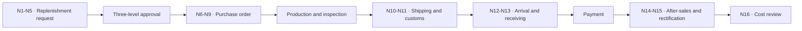
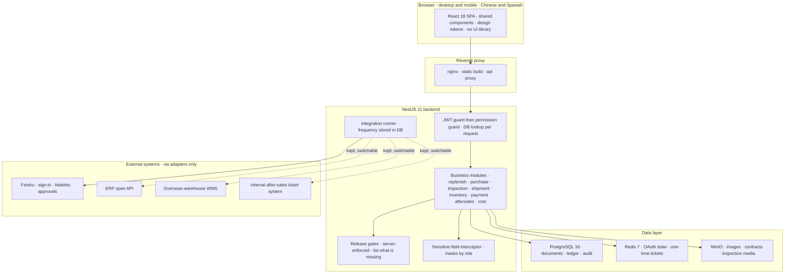

# Supply Chain Middle Office

**One system for the whole goods flow — from replenishment request to cost review, across 11 roles.**

An internal cross-border supply-chain system covering operations, purchasing, quality control, logistics, warehouse, finance and after-sales. NestJS 11 + Prisma 6 + React 18 with no UI library, on PostgreSQL, Redis and MinIO; a pnpm monorepo shipped as an offline Docker package onto an internal NAS.

[Overview](#-overview) · [Main Chain](#-main-chain-n1n16) · [Architecture](#-architecture) · [Design Highlights](#-design-highlights) · [Guard Rails](#-guard-rails) · [Tech Stack](#-tech-stack)

**English** · [简体中文](README.zh.md)

> [!NOTE]
> This is a **documentation-only showcase**: no source code is published here. The implementation lives in a private repository and runs on an internal deployment. Contact the author to arrange a guided code walkthrough.

## 📌 Overview

Goods for an overseas market move through many hands: operations ask for stock, purchasing places orders with factories, QC inspects, logistics books containers and customs, the warehouse receives, finance pays, and after-sales handles complaints. Before this system, each step lived in its own spreadsheet, and nobody could see where an order was stuck.

The middle office puts the whole chain — sixteen nodes, N1 to N16 — into one database. Every document has an owner role and a clear next step; approvals, release gates and overdue warnings are enforced by the server, not by convention. Each of the 11 roles gets a workbench that shows exactly what is waiting for them, in Chinese or Spanish.

Around the main chain sit the supporting domains: accessory orders, new-product development, a compliance-certificate ledger with expiry tracking, supplier admission and performance, and a product library whose master data stays in sync with a Feishu Bitable.

## 🔗 Main Chain · N1–N16

- **Replenishment**: one SKU per line, stock and MOQ checks, then approval by the operations director, the purchasing manager and the general manager — any rejection returns to the start.
- **Purchase orders**: contract, deposit and packaging gate before production; a pre-production check freezes a **compliance snapshot** that later master-data edits do not change; delivery delays raise warnings automatically.
- **Inspection**: desktop plus a mobile page with camera capture, client-side compression and offline drafts. A major defect has **no release path**; after three failed re-inspections a manager decides.
- **Shipping and receiving**: the required customs elements are validated by the server; quantity differences become exceptions automatically; stock is an append-only ledger plus balances, traced by batch.
- **After-sales**: tickets import idempotently by external number; the trace runs serial number → batch → purchase order → supplier → inspection report; a repeated failure of the same part in the same month opens a rectification order.
- **Cost review**: landed costs are allocated with the rounding remainder absorbed by the last line; a deviation beyond a set threshold opens an exception.

## 🏗 Architecture

Edits arriving from external tables never overwrite the database: they become **repair requests** assigned to a person. Pushing product data back out goes through a single service entry point with an outbox queue and a hold switch, so a release freeze is one toggle, not a code change.

## 💡 Design Highlights

**Gates cannot be skipped.** Release conditions throw when unmet and list exactly what is missing; the UI shows the same reason next to the disabled button. There is no frontend-only enforcement anywhere in the chain.

**Stock is ledger-driven.** Inventory transactions are append-only and balances use optimistic locking; a reconcile endpoint finds any mismatch between the two.

**Business-rule violations are not HTTP errors.** They return a structured refusal with a reason code, rendered bilingually by the UI; HTTP status codes are reserved for auth and malformed input.

**One source of truth for permissions.** A single shared permission table drives both the API guards and the menu, so a page you can see never answers 403. Permissions are never embedded in the JWT — every request checks the database, so disabling an account takes effect on its next request.

**Snapshots protect history.** The pre-production check freezes the compliance data a batch was built against; after-sales traces always resolve against the org and master data as they were.

## 🛡 Guard Rails

- **Every list is paginated** — "x–y of N", selectable page size, reset to page 1 on any filter change — and a `tablePaging` guard test fails the build for any table without it.
- **No hardcoded UI text**: new strings enter only through a script that adds Chinese and Spanish together; a `noHardcodedText` test catches literals.
- **The bilingual release log is test-guarded**: every deploy adds a Chinese/Spanish entry, and a test rejects any Spanish entry containing Chinese characters.
- **API coverage is scanned**: frontend endpoint addresses must be plain literals so a scanner can prove every called route exists.
- **Tests never touch the main database**: API suites run on a throwaway database created per run, with the external platform faked — the test harness blocks real outbound calls.
- **Masking happens on the server** — nested objects, exports and prints included — never in the browser.
- **No self-approval**, and built-in admin invariants are enforced in serializable transactions.
- **Schema changes only through versioned migrations**; the destructive shortcut path is banned and documented.

## 🧱 Tech Stack

| Layer | Choice |
|---|---|
| Repository | pnpm workspace monorepo: API, web, and a shared package for permission keys, enums and table-column rules |
| Backend | NestJS 11, Prisma 6 on PostgreSQL 16, scheduled jobs with lease locks |
| Cache / storage | Redis 7 for OAuth state and one-time tickets; MinIO for files and media |
| Frontend | React 18.3 + Vite, react-i18next for Chinese/Spanish, shared components and design tokens — no UI library |
| Auth | Feishu-only OAuth sign-in; the JWT never travels in a URL; permissions looked up per request |
| Testing | Vitest on the web app, 1,392 tests; API suites on a throwaway database |
| Deployment | Offline Docker Compose package installed onto an internal NAS; data only in named volumes |

## 📄 License

All rights reserved. Documentation only; no license is granted for the described implementation.
