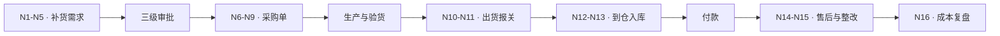
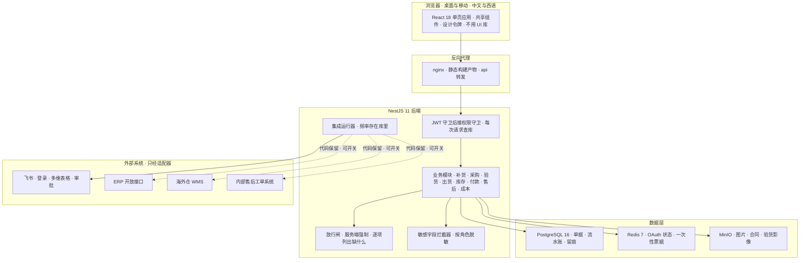

# 供应链中台

**一套系统管住整条货流 —— 从补货需求到成本复盘，横跨 11 个岗位。**

跨境业务的供应链内部系统，覆盖运营、采购、品控、物流、仓库、财务、售后。NestJS 11 + Prisma 6 + React 18（不用 UI 库），PostgreSQL + Redis + MinIO；pnpm monorepo，打成离线 Docker 包装进内部 NAS。

[概述](#-概述) · [主链路](#-主链路--n1n16) · [架构](#-架构) · [设计要点](#-设计要点) · [工程铁律](#-工程铁律) · [技术栈](#-技术栈)

[English](README.md) · **简体中文**

> [!NOTE]
> 这是一份**纯文档 showcase**：本仓库不包含任何源码。实现在私有仓库中，运行于内部环境。如需了解实现细节，可联系作者安排代码走读。

## 📌 概述

发往海外市场的货要经过很多双手：运营提补货，采购向工厂下单，品控验货，物流订柜报关，仓库收货，财务付款，售后处理投诉。在这套系统之前，每个环节各管各的表格，没人说得清一张单子卡在哪里。

中台把整条链路 —— 十六个节点，N1 到 N16 —— 放进一个数据库。每张单据有归属岗位、有明确的下一步；审批、放行条件、超期预警都由服务端强制，而不是靠口头约定。11 个岗位各有一个工作台，用中文或西语，一眼看到等着自己的事。

主链路之外是配套领域：配件单、新品开发、带到期跟踪的合规证书台账、供应商准入与绩效，以及与飞书多维表格保持同步的产品库主数据。

## 🔗 主链路 · N1–N16

- **补货**：一行一个 SKU，先过库存与 MOQ 检查，再依次由运营总监、采购经理、总经理审批 —— 任何一级驳回都回到起点。
- **采购单**：生产前要过合同、定金、包装三道登记闸；产前检查会冻结一份**合规快照**，之后改主数据也动不了它；交期延误自动预警。
- **验货**：桌面端之外还有移动页 —— 拍照采集、端上压缩、离线草稿。主要缺陷**没有放行路径**；复检三次不过，由经理裁决。
- **出货与入库**：报关要素由服务端校验；数量差异自动生成异常；库存是只追加的流水账加余额表，按批次追溯。
- **售后**：工单按外部单号幂等导入；追溯链是 序列号 → 批次 → 采购单 → 供应商 → 验货报告；同一配件同月再次故障自动开整改单。
- **成本复盘**：到岸成本分摊，舍入余数由最后一行吸收；偏差超过阈值自动开异常。

## 🏗 架构

从外部表格传回来的改动从不直接覆盖数据库：它们变成指派到人的**修复请求**。向外回写产品数据只有一个服务入口，带发件箱队列和暂缓开关 —— 冻结发布是拨一下开关，不是改一行代码。

## 💡 设计要点

**放行闸跳不过去。** 放行条件不满足就抛错，并逐项列出缺什么；界面在置灰按钮旁边显示同样的原因。整条链路没有任何一处只靠前端把关。

**库存由流水账驱动。** 库存事务只追加，余额表用乐观锁；对账接口能找出两者之间的任何不一致。

**业务规则违例不是 HTTP 错误。** 返回带原因码的结构化拒绝，由界面渲染成双语文案；HTTP 状态码只留给鉴权和非法输入。

**权限只有一个出处。** 同一张共享权限表同时驱动 API 守卫和菜单，所以看得见的页面永远不会回 403。权限从不写进 JWT —— 每次请求都查库，停用账号下一次请求立即生效。

**用快照保护历史。** 产前检查冻结该批次依据的合规数据；售后追溯永远按当时的组织与主数据解析。

## 🛡 工程铁律

- **列表一律分页** —— 显示「第 x–y 条，共 N 条」、每页条数可选、筛选变化回到第 1 页 —— 守卫测试 `tablePaging` 会拦下任何没分页的表格。
- **界面文案不写死**：新词条只能通过脚本进入，中西两份同时加；`noHardcodedText` 测试拦截字面量。
- **双语更新日志有测试把守**：每次上线都要加一条中西双语记录，测试会拒绝任何含中文字符的西语词条。
- **接口覆盖有扫描器**：前端调用的接口地址必须写成纯字面量，扫描器据此证明每条被调用的路由都存在。
- **测试绝不碰主库**：API 套件在每次新建的临时库上跑，外部平台用假实现 —— 测试环境会拦截真实外呼。
- **脱敏在服务端完成** —— 嵌套对象、导出、打印一并覆盖 —— 从不交给浏览器。
- **不能审批自己的单**；内置管理员不变量在可串行化事务里强制。
- **表结构只走版本化迁移**；破坏性捷径被明令禁止并写进文档。

## 🧱 技术栈

| 层 | 选型 |
|---|---|
| 仓库 | pnpm workspace monorepo：API、web，外加存放权限 key、枚举与表格列规则的共享包 |
| 后端 | NestJS 11、Prisma 6 + PostgreSQL 16、带租约锁的定时任务 |
| 缓存 / 存储 | Redis 7 存 OAuth 状态与一次性票据；MinIO 存文件与影像 |
| 前端 | React 18.3 + Vite、react-i18next 中西双语、共享组件与设计令牌 —— 不用 UI 库 |
| 鉴权 | 只用飞书 OAuth 登录；JWT 从不进 URL；权限每次请求查库 |
| 测试 | 前端 Vitest 1392 项；API 套件跑临时库 |
| 部署 | 离线 Docker Compose 包装进内部 NAS；数据只在命名卷里 |

## 📄 许可

保留所有权利。本仓库仅为文档；不对所述实现授予任何许可。
